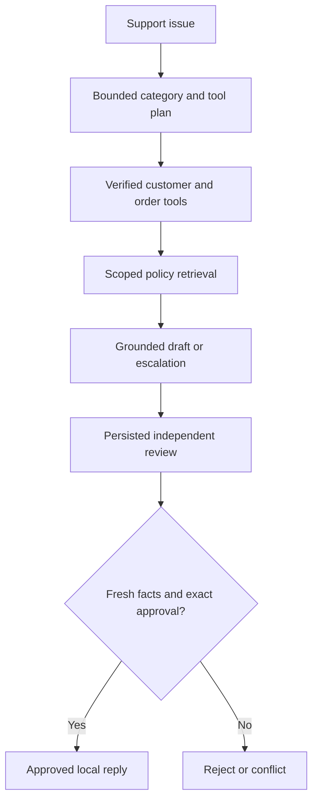

# Support Case Agent
[](https://github.com/AmmarFarid10/support-case-agent/actions/workflows/ci.yml)

**Turn a customer issue, verified order facts and current company policy into a cited reply for human review.** Support staff need to inspect account context and policy without inventing refunds, shipping dates or billing promises. This bounded agent selects read tools, retrieves the relevant policy, drafts supported extracts and pauses before releasing a reviewed reply.

## Concrete demonstration
A fictional business customer reports a damaged switch. The workflow reads the customer's own delivered order, retrieves return policy and drafts a reply containing verified status and policy quotes. Reviewer-only fraud notes are excluded. An independent reviewer can approve a local reply artifact; no email, refund or commerce operation is executed.

## What is implemented
- Typed customer/order imports with consistency checks and tenant-scoped repository access.
- A bounded LangGraph workflow with actual customer/order/policy tools and durable checkpoints.
- Rules or optional Ollama issue classification and tool planning; invalid tools or dependency order fail closed.
- Pretrained/BM25 hybrid policy retrieval with active revisions, source citations and pre-ranking access filters.
- Extractive or local-model quote selection. Invented citations and unsupported text are removed and the case escalates.
- Verified facts render through templates; the model cannot write a new order status, promise a refund or invent an arrival date.
- Reviewer-only notes are excluded from customer-visible retrieval even when the requester is a reviewer.
- Exact-hash, expiring, independent review. Changes to customer facts or the applicable policy set invalidate pending replies.
- Decision and approved-reply storage share a transaction; replay cannot create duplicate effects. The API explicitly reports `sent_externally:false`.

## Run it
Python 3.12 and uv are required. Start with the self-contained API demo; it creates temporary data and fresh test identities and makes no external model/service calls:

```bash
uv sync --frozen --extra dev
uv run python scripts/demo.py --check
```
Then run the same demo using the pretrained ONNX embedding model:

```bash
uv run python scripts/demo.py --semantic
RUN_SEMANTIC=1 uv run pytest -q -m semantic
uv run python scripts/evaluate.py --semantic
```
FastEmbed downloads the public `BAAI/bge-small-en-v1.5` quantized model on first use. It runs on CPU through ONNX Runtime; no model training or paid API is required. The model has an MIT license according to its upstream model metadata. `MODEL_CACHE` controls caching. The dependency lock pins Python packages, not an immutable future copy of model-hosted weights; see the recorded model manifest in `docs/` and re-embed documents when changing model/version. Hash mode is an explicitly labeled lexical baseline, not semantic AI.

For a persistent API:

```bash
eval "$(uv run python scripts/make_keys.py)"
EMBEDDER=fastembed uv run uvicorn app.api:app --host 127.0.0.1 --port 8000 --workers 1
```
The key generator prints one shell export containing an operator and a different reviewer. Keep that environment local and never commit its output. Copy the appropriate key from `AUTH_KEYS_JSON` into `Authorization: Bearer <key>` in `/docs`. Each identity's tenant, subject and role are server configured; request JSON cannot override them. `/health` and API schema are public; business endpoints require authentication.

`EMBEDDER=hash` runs a reproducible offline lexical-vector baseline. `EMBEDDER=fastembed` is the default. An index stores the selected encoder name and will not silently mix vectors from different encoders: re-ingest documents after changing it.

```bash
docker compose up --build
```
Compose binds only `127.0.0.1:8000`; change the host port to run multiple projects together. Storage and model caches use named volumes. The image runs as a non-root user. Docker on Linux uses a host-gateway mapping for an existing local Ollama server; Docker Desktop uses the same hostname.

Optional local LLM features use an existing Ollama `qwen3:4b`. Set `OLLAMA_MODEL` for another installed model and keep `OLLAMA_BASE_URL` on the supported local endpoint. No remote paid-provider fallback occurs. A missing model produces an explicit API error or failed workflow rather than a fabricated answer. Network/timeouts and 429/5xx responses have bounded retries; malformed JSON and invalid schemas fail closed. This repo includes transport-mocked model tests. Live Ollama generation is not claimed as tested in this review.


## API walkthrough
1. POST `/documents` using the sample policies. `entity` is `returns`, `shipping` or `billing`; restricted notes use `scope:"reviewers"` and require a reviewer to ingest.
2. POST `/customers` with verified records from your own CRM/export, or the synthetic fixture.
3. POST `/cases` with `customer_id`, optional `order_id`, `message` and an `Idempotency-Key`. Order IDs are checked against the selected customer.
4. Inspect the draft, source quotes, verified facts and escalation flag. `planner:"ollama"` enables model tool planning; `draft:"ollama"` enables model quote selection. Offline modes remain clearly labeled.
5. A different same-tenant reviewer POSTs `/cases/{id}/decision` with the exact proposal hash.
6. GET `/cases/{id}/reply` returns the approved local reply. Integrating an external delivery adapter would require separate authorization, provider idempotency and reconciliation; this project does not send messages.

The run ledger is authoritative after an effect is committed, even if the final graph checkpoint is interrupted. A retry returns the same local reply, not another delivery. The policy corpus is assumed to be staff-maintained; exact quote validation confirms provenance, not whether a policy is correct or appropriate for a particular customer.



## Quality and operating limits
```bash
uv run ruff check .
uv run mypy app --ignore-missing-imports
uv run pytest -q -m 'not semantic'
uv run pip-audit
```
GitHub Actions runs the checks, an end-to-end API demo, and a Docker build plus containerized demo. The manual **Pretrained retrieval check** workflow downloads and executes actual embeddings and reports a small retrieval ablation. The same evaluation can be reproduced locally. `docs/VERIFICATION.md` records executed results; `docs/EXPERIMENTS.md` explains trade-offs. Synthetic fixtures demonstrate mechanics, not production accuracy or customer outcomes.

This is an independently runnable reference implementation, not a claim of a production deployment. SQLite and a process lock support **one worker**. Multi-worker deployment needs database-backed run locking, a shared checkpoint backend, tenant quotas and retention/backup operations. Configure TLS and real identity management before exposure. API keys are configured through the environment; there is no signup/password service. Request bodies, document size and CSV size (where used) are bounded. Input is treated as untrusted data; exact quote checks reduce unsupported claims but cannot certify source truth or defeat every prompt injection.

Application events store identifiers, hashes, statuses and counts, not credentials, uploaded content or model prompts. Request IDs and duration headers support tracing. Returned proposals and evidence intentionally include authorized source excerpts, so restrict downstream logging and retention. Schema version 1 is explicit; a future incompatible schema requires a migration rather than deleting existing data.

`app/core` is intentionally shared infrastructure across this portfolio's three projects. Each repository includes its own copy for standalone installation; domain services, datasets, workflow invariants and evaluations are project-specific. A larger organization could extract the common code into a separately versioned internal package.

